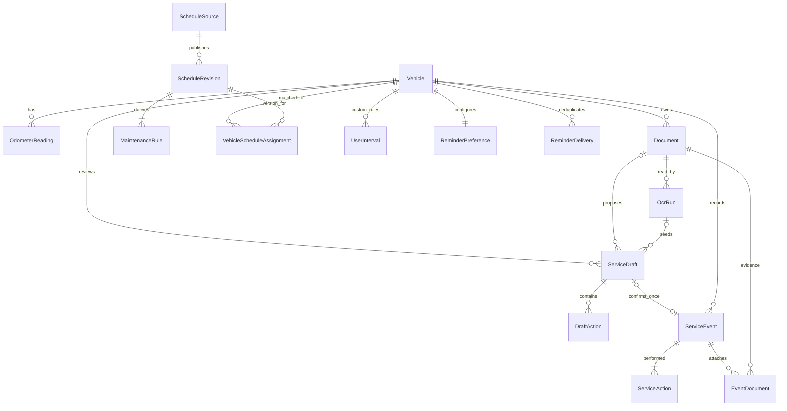

# Model danych — projekt logiczny v1

To kontrakt projektowy dla lokalnej bazy, nie gotowy schemat SQL ani migracja Room. W Etapie 2 wdrażamy tylko fundament potrzebny na ten moment; pozostałe encje w etapach funkcjonalnych. Bez tabel kont, flot, płatności i synchronizacji na zapas.

## Konwencje i granice

- Identyfikatory UUID nadawane lokalnie, nie VIN jako klucz główny.
- `LocalDate` dla dnia wykonania, odczytu i terminów kalendarzowych; `Instant` UTC dla zdarzeń technicznych. Język nie zmienia daty wykonania.
- Przebieg: nieujemna liczba całkowita w kilometrach; zachowany oryginalny tekst i jednostka z dokumentu w surowym OCR. Nie interpretujemy niejednoznacznego „59.200” bez sprawdzenia.
- Kwoty: integer w najmniejszej jednostce + kod waluty, bez float. Puste pole oznacza brak danych, nie zero.
- Wartości `null` znaczą „nieznane”; nie zastępujemy ich fikcyjnym 0 km, datą zakupu ani importu.
- `createdAt` i `updatedAt` na obiektach edytowalnych; `editVersion` szkicu do wykrycia nieaktualnego potwierdzenia. Nie jest to system wersjonowania wieloużytkownikowego.
- Tylko ścieżki względne wyznaczone przez aplikację. Nazwa pliku użytkownika nie jest ścieżką zapisu.

## Relacje

Diagram pokazuje relacje główne; np. `currentReadingId` jest dodatkowym odwołaniem wewnątrz tego samego pojazdu, opisanym poniżej. Relacja szkic→wpis jest opcjonalna po obu stronach i najwyżej 1:1, nie 1:n.

## 1. Pojazd i przebieg

| Encja | Pola i znaczenie | Spójność |
| --- | --- | --- |
| `Vehicle` | `id`, `displayName`, marka/model/generacja, `modelYear?`, `firstRegistrationDate?`, VIN/tablica opcjonalne, kody silnika/skrzyni?, rynek?, tryb serwisowy?, `configurationRevision`, `currentReadingId?` | Wymagane ID i czytelna nazwa. VIN po normalizacji nie dubluje innego aktywnego auta w garażu. Nieznany kod nie jest zgadywany. Zmiana pól istotnych dla planu podnosi rewizję i oznacza dopasowanie do ponownej oceny |
| `OdometerReading` | `id`, `vehicleId`, `observedOn`, `distanceKm`, `origin` MANUAL / SERVICE_CONFIRMED, `serviceEventId?`, `exceptionReason?` | Dystans ≥0; dzień nie w przyszłości dla faktycznego pomiaru. `serviceEventId` najwyżej raz. Odczyt bieżący musi należeć do tego samego auta |

Nie wybieramy bieżącego odczytu przez `MAX(km)`. `Vehicle.currentReadingId` wskazuje odczyt wybrany przez użytkownika. Nowy ręczny odczyt może zostać bieżącym po walidacji; starsza faktura nie zastępuje go automatycznie. Przy równych datach i różnych wartościach potrzebne jest wyjaśnienie/wybór. Wymiana licznika wymaga oznaczenia; bez dodatkowej reguły przeliczenia nie łączymy obu skali w jeden przebieg serwisowy.

Usunięcie wskazanego odczytu ustawia `currentReadingId = null` i prowadzi do stanu „uzupełnij przebieg”, zamiast zgadywać nowy aktualny odczyt. Usunięcie wpisu serwisowego usuwa jego pochodny odczyt; jeśli był bieżący, obowiązuje ta sama zasada.

## 2. Dokument, odczyt i szkic — bez wykonanych usług

| Encja | Pola i znaczenie | Spójność |
| --- | --- | --- |
| `Document` | `id`, `vehicleId`, `originalName`, `relativePath`, MIME, rozmiar, liczba stron?, SHA-256, `importedAt`, `fileState` STAGING / READY / MISSING | Dostęp tylko do prywatnego pliku. Identyczne bajty dla tego samego auta wskazują istniejący dokument, nie nowy wpis. Niepewne wizualne duplikaty wymagają osobnej oceny |
| `OcrRun` | `id`, `documentId`, `state` QUEUED / PROCESSING / SUCCEEDED / FAILED / CANCELLED, SDK/model/parser version, `startedAt`, `finishedAt?`, `rawPayload`, `errorCode?` | Każda próba osobno. Surowy wynik jest niezmienny po zakończeniu i nigdy nie zasila silnika reguł. Nie trafia do logów |
| `ServiceDraft` | `id`, `vehicleId`, `documentId?`, `ocrRunId?`, data wykonania?, przebieg?, kwota/waluta?, typ dokumentu, notatka?, `state` OPEN / REVIEW_REQUIRED / CONFIRMED / DISCARDED, `editVersion`, `reviewedVersion?`, `confirmedAt?` | Manualny szkic nie wymaga dokumentu. Jeśli jest `ocrRunId`, musi dotyczyć wskazanego dokumentu i auta. `reviewedVersion` zgodne z `editVersion` w momencie potwierdzenia |
| `DraftAction` | `id`, `draftId`, `actionCode?`, nazwa własna?, `operation`, `classification` PERFORMED / RECOMMENDATION / QUOTE / PARTS_ONLY / UNKNOWN, `selected`, `evidence?` | Do historii przechodzą tylko świadomie wybrane czynności PERFORMED. Brak kodu pozostaje wpisem opisowym, bez arbitralnego dopasowania do reguł |

`rawPayload` i `evidence` mają wersjonowany, walidowany format danych, nie wykonywalny kod. Dowód pola: numer strony, fragment tekstu i opcjonalny prostokąt w znormalizowanych współrzędnych. `evidence` szkicu może wskazać zarówno datę, przebieg, jak i konkretną czynność. Zachowujemy odczyt oryginalny oraz poprawioną wartość osobno. Ręczna poprawka nie nadpisuje surowego odczytu.

Przed potwierdzeniem wymagane: poprawna data wykonania, ≥1 wybrana wykonana czynność, brak nierozwiązanego konfliktu auta i aktualne potwierdzenie sprawdzenia. Brak przebiegu jest dozwolony, lecz nie daje automatycznej podstawy do obliczenia km. Klasyfikacja dokumentu może być mieszana: oryginał może zawierać wykonane usługi i zalecenia, lecz tylko wybrane wykonane pozycje przechodzą do historii.

### Potwierdzenie szkicu — jedna transakcja

1. Sprawdź `state` i `editVersion`; szkic CONFIRMED/DISCARDED nie może zostać potwierdzony ponownie.
2. Zweryfikuj pola, identyfikację pojazdu i wybrane pozycje.
3. Utwórz `ServiceEvent` z unikalnym `sourceDraftId`, jego czynności i powiązania z dokumentem.
4. Jeśli podano przebieg, utwórz odczyt powiązany z wydarzeniem; bieżący odczyt zmieniaj tylko po jawnym wyborze użytkownika i walidacji.
5. Oznacz szkic CONFIRMED. Zatwierdź całość albo wycofaj całość.
6. Po commit przelicz widok i uzgodnij zadania przypomnień. Ponowienie uzgodnienia musi być bezpieczne i nie tworzyć dodatkowej historii.

Unikalność `ServiceEvent.sourceDraftId` oraz stan szkicu zabezpieczają przed podwójnym kliknięciem i ponowieniem po awarii. Usunięcie wpisu nie przywraca starego szkicu do OPEN; ponowne świadome utworzenie wpisu wymaga nowego szkicu. Nie wprowadzamy do modelu trwałego checkboxa „bezpieczne”, który byłby aktualny po zmianie danych.

Plik i baza nie tworzą jednej transakcji systemowej. Import najpierw trafia do prywatnego katalogu tymczasowego, jest walidowany, a potem otrzymuje stan READY i rekord. Sprzątanie po przerwaniu usuwa osierocone pliki tymczasowe; wpis usługi nie wskazuje niezatwierdzonego pliku STAGING. Usuwanie plików ma procedurę ponowienia, zamiast obietnicy atomowości bazy i systemu plików.

## 3. Potwierdzona historia

| Encja | Pola i znaczenie | Spójność |
| --- | --- | --- |
| `ServiceEvent` | `id`, `vehicleId`, `performedOn`, `sourceDraftId?` UNIQUE, pochodzenie MANUAL / DOCUMENT_CONFIRMED / DOCUMENT_REMOVED, koszt/waluta?, notatka, `confirmedAt`, daty edycji | ≥1 `ServiceAction`; wykonywane w przeszłości/dzisiaj, nie planowana wizyta. Potwierdzający to użytkownik, nie audytor warsztatu |
| `ServiceAction` | `id`, `eventId`, `actionCode?`, `customLabel?`, `operation` REPLACE / INSPECT / TEST / OTHER, `evidence?` | Bez kodu wymagany własny opis. Kod i operacja łącznie decydują o dopasowaniu do reguły |
| `EventDocument` | `eventId`, `documentId` | Para unikalna; oba obiekty należą do tego samego pojazdu. Dokument może wspierać kilka świadomie utworzonych wydarzeń |

Do silnika trafiają tylko te encje i potwierdzone odczyty, nigdy `DraftAction`, `OcrRun` ani sam fakt istnienia dokumentu.

Usunięcie dokumentu nie oznacza niewykonania usługi: użytkownik wybiera „usuń tylko dokument” lub przechodzi do osobnego usunięcia wpisu. Pierwsza opcja usuwa oryginał, miniatury, surowe OCR, dowody tekstowe i szkice tego dokumentu. Wydarzenie zachowuje ręcznie zatwierdzone wartości, odłącza `sourceDraftId`, jeżeli wskazywał szkic usuniętego dokumentu, i traci dowody odnoszące się do usuwanego pliku. Jeśli utraciło ostatni dokument, zmienia pochodzenie na DOCUMENT_REMOVED; pozostałe załączniki nie znikają. Potwierdzony wpis nie może udawać, że nadal ma dokument. Usunięcie całego auta/garażu usuwa wszystkie powiązane informacje, także szkice.

## 4. Źródła i reguły

| Encja | Pola i znaczenie | Spójność |
| --- | --- | --- |
| `ScheduleSource` | `id`, dostawca/tytuł, URI lub prywatny numer dokumentu, `rightsStatus` PENDING / APPROVED / WITHDRAWN, referencja warunków, zasady cache/eksportu | Status APPROVED wynika z udokumentowanej oceny uprawnień, nie z wyniku OCR ani zaznaczenia przez kierowcę |
| `ScheduleRevision` | `id`, `sourceId`, wersja, data weryfikacji, aktualność i ważność cache, zakres konfiguracji, wymagane parametry, wersja schematu | Rewizja niezmienna po dopuszczeniu. Nowa wersja tworzy nowy rekord; źródło może zostać wycofane |
| `MaintenanceRule` | `id`, `scheduleRevisionId`, kod czynności, operacja, `ruleKind`, pierwszy/kolejne progi czasu i km, punkt początkowy, zasada łączenia granic, warunki stosowania i dowód źródła | Tylko jawnie obsługiwany format reguły; nie interpretujemy dowolnego tekstu lub kodu dostawcy jako programu |
| `VehicleScheduleAssignment` | `id`, `vehicleId`, `scheduleRevisionId`, `configurationRevision`, stan MATCHED / INCOMPLETE / REVIEW_REQUIRED / WITHDRAWN, powód, data dopasowania, `active` | Najwyżej jedno aktywne przypisanie planu na auto; MATCHED wymaga wszystkich wymaganych pól i aktualnych praw |
| `UserInterval` | `id`, `vehicleId`, kod/opis czynności, operacja, km? i miesiące?, własny punkt startowy: data/przebieg/wpis, aktywność, daty zmian | Co najmniej jedna dodatnia granica. Widoczne pochodzenie USER; nigdy nie staje się regułą producenta |

Minimalne rodzaje reguł: FIRST_THEN_REPEAT, ABSOLUTE_MILESTONE, CONDITION_BASED. Granice i punkty startowe nie mogą być domyślane: pierwsza rejestracja, produkcja, dostarczenie, ostatnia wykonana czynność lub inna jawna podstawa zależnie od źródła. Brak wymaganej daty → „Potrzebne dane”.

Dla czasu i km zapisujemy, czy wystarczy przekroczenie dowolnej granicy, czy źródło mówi coś innego. Reguła warunkowa wymagająca niedostępnego odczytu z auta daje komunikat o ograniczeniu, nie fikcyjną datę. Szczegółową semantykę i przypadki graniczne wykonamy w Etapie 4 na podstawie dopuszczonego źródła.

### Wynik jest wyliczeniem

`ServiceForecast` to wynik obliczenia, **nie tabela będąca źródłem prawdy**. Obejmuje: auto, wersję reguły lub własnego interwału, wykorzystane wydarzenia i odczyt, chwilę/dzień oceny, terminy, stan, brakujące dane i ewentualną oznaczoną prognozę. Dwa niezależne wymiary:

- `evidenceState`: READY / HISTORY_MISSING / CONFIGURATION_INCOMPLETE / SOURCE_INVALID / CONDITION_INPUT_MISSING;
- `urgency`: OVERDUE / DUE_SOON / NOT_SOON / UNKNOWN, tylko w zakresie, który da się uzasadnić.

Aktualność przebiegu osobno, nie jako dowód zaległości. Dopuszczalne jest policzenie granicy czasowej przy nieznanym przebiegu, z jawną informacją o nieznanym wymiarze km. Brak historii nie resetuje licznika. Zmiana historii, konfiguracji lub źródła unieważnia poprzedni wynik.

## 5. Przypomnienia i ustawienia

| Encja / miejsce | Dane | Spójność |
| --- | --- | --- |
| DataStore `AppPreferences` | język, aktywne auto, ukończenie startu | Język nie zmienia danych oryginalnych; aktywne auto musi istnieć |
| `ReminderPreference` | `vehicleId` UNIQUE, włączone, progi zbliżania, częstotliwość, przypomnienie o przebiegu | Uprawnienie OS sprawdzane w systemie, nie traktowane jako niezmienny bool w bazie |
| `ReminderDelivery` | `id`, `vehicleId`, dokładnie jedno: `maintenanceRuleId` albo `userIntervalId`, fingerprint podstawy/terminu, okno wysyłki, `deliveredAt?`, stan | Unikalna kombinacja celu, wersji terminu i okna chroni przed powtórką; edycja/usunięcie anuluje nieaktualne zadania |

Zadania WorkManager to wykonanie, nie źródło interwału. Nie mogą dowieść, że auto faktycznie przejechało kolejne kilometry. Włączenie powiadomień nie upoważnia do zmiany harmonogramu.

## Usuwanie, eksport i odtworzenie

| Działanie | Skutek |
| --- | --- |
| Usuń szkic | DraftAction i szkic znikają; dokument może zostać. Nie zmienia potwierdzonej historii |
| Usuń wpis | Czynności, połączenia z dokumentami i pochodny odczyt znikają; oryginał dokumentu może zostać. Ponowne przeliczenie |
| Usuń dokument | Plik i pochodne OCR/dowody znikają; potwierdzone wartości mogą zostać po świadomym wyborze, z informacją o usuniętym dokumencie |
| Usuń auto | Cały agregat użytkownika: odczyty, dokumenty, szkice, historia, własne reguły, przypomnienia i przypisania. Wspólny licencjonowany katalog nie jest dokumentem użytkownika |
| Usuń wszystkie dane | Cały garaż, ustawienia i lokalne kopie/cache; brak zdalnego konta do usuwania. Nie usuwa kopii wyeksportowanych poza aplikację |
| Eksport | Wersja formatu, własne dane i dokumenty, sumy kontrolne; obce treści tylko według licencji. Sekrety, cache dostawców i surowe logi poza eksportem |
| Odtworzenie | Walidacja wersji, limitów, ścieżek, sum i relacji w obszarze tymczasowym; podgląd, wybór strategii i commit. Niepowodzenie pozostawia obecną historię bez zmian |

Dane źródłowe objęte zakazem redystrybucji nie trafiają do publicznego repo ani eksportu. Zachowanie po wygaśnięciu licencji ustala umowa; utrata prawa do planu nie kasuje prywatnej historii użytkownika. Szczegóły retencji i kopii sprawdzamy w Etapie 7, a reguły backupu projektujemy już w fundamencie.
