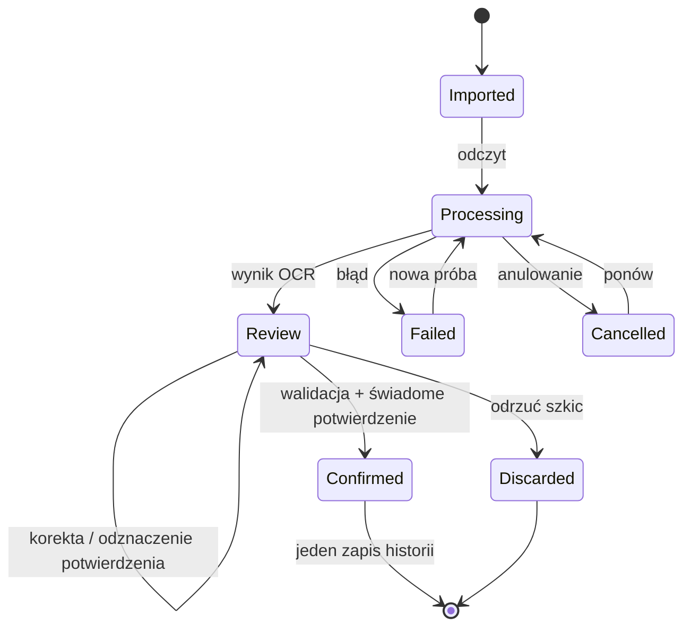

# Stany i scenariusze odbioru

## Cykl dokumentu i szkicu

Status dokumentu/odczytu nie jest statusem wykonania usługi. Dokument może istnieć bez wpisu. Potwierdzona historia nie powstaje ze stanu `Processing`, `Failed` ani samego `Review`.

## Macierz stanów

| ID | Ekran / warunek | Komunikat i dostępne działanie | Wpływ na dane |
| --- | --- | --- | --- |
| ST-01 | Nowa instalacja | Wybierz język, dodaj auto | Brak pustego „zdrowego” pojazdu |
| ST-02 | Pusta historia | Dodaj dokument lub wpis ręczny | Brak automatycznych wykonanych usług |
| ST-03 | Brak harmonogramu | Brak potwierdzonego planu; uzupełnij konfigurację / własny interwał | Historia i OCR dostępne; brak OEM terminów |
| ST-04 | Brak historii dla znanej reguły | Brak potwierdzenia w dokumentacji; dodaj historię | Nie zakładamy punktu startowego 0 km |
| ST-05 | Nieaktualny odczyt | Ostatni odczyt z datą; zaktualizuj | Dane czasowe mogą działać; wynik km opisany jako oparty na starym odczycie |
| ST-06 | Offline | Dane lokalne dostępne; lookup/aktualizacja źródła do ponowienia | Lokalny OCR i historia nie są blokowane |
| ST-07 | Plan wygasły/wycofany lub zmienione auto | Plan wymaga weryfikacji, pokaż powód | Nie przedstawiamy starego dopasowania jako aktualnego |
| ST-08 | Nieczytelne zdjęcie | Zrób nowe zdjęcie / wpisz ręcznie | Pozostaje szkic lub dokument bez usługi |
| ST-09 | PDF zabezpieczony/nieobsługiwany | Wybierz odblokowaną kopię lub zdjęcie | Brak automatycznej próby chmurowej |
| ST-10 | Za duży dokument | Limit przed importem; wybierz mniejszy plik | Brak częściowego wpisu |
| ST-11 | Identyczny dokument | Otwórz istniejący dokument | Brak duplikatu dokumentu i usługi |
| ST-12 | Możliwy duplikat | Porównaj z wpisem; decyzja po sprawdzeniu | Nie łączymy automatycznie dwóch faktur |
| ST-13 | Dokument innego auta | Sprawdź identyfikator / wybierz właściwe auto | Zapis do niewłaściwego pojazdu zablokowany |
| ST-14 | Niepewne pola OCR | Sprawdź fragment i popraw | Potwierdzenie potrzebne po każdej korekcie |
| ST-15 | Wycena, zalecenie, zakup części | Zachowaj dokument; brak potwierdzonej usługi | Nie resetuje interwału |
| ST-16 | Anulowanie/przerwanie OCR | Ponów lub wpisz ręcznie | Oryginał może pozostać; usługi nie powstają |
| ST-17 | Brak miejsca / błąd zapisu | Nic nie zapisano do historii; spróbuj ponownie | Transakcja nie pozostawia połowy wpisu |
| ST-18 | Nieprawidłowa data/przebieg | Błąd przy polu i wyjaśnienie | Zapis zablokowany do poprawy lub jawnego dopuszczalnego wyjątku |
| ST-19 | Starszy wpis przebiegu | Zachowaj historię; nie ustawiaj jako bieżący | Bieżący odczyt pozostaje wybrany |
| ST-20 | Odmowa aparatu/powiadomień | Wybierz plik / włącz uprawnienie później | Reszta aplikacji dostępna |
| ST-21 | Usunięcie wpisu/dokumentu | Potwierdź wpływ i zakres | Usługa i załącznik są osobnymi obiektami; zachowanie opisane w modelu |
| ST-22 | Eksport/odtworzenie nieudane | Wyjaśnienie, ponowienie; istniejące dane bez zmian | Weryfikacja i przygotowanie przed atomowym odtworzeniem |

Makieta udostępnia reprezentatywne stany z panelu scenariuszy; pozostałe są kontraktem zachowania do implementacji/testów w późniejszych etapach, nie działającymi funkcjami.

## Scenariusze odbioru projektu

| ID | Przejście | Oczekiwany wynik projektu |
| --- | --- | --- |
| UX-A | Start → auto → pulpit → wpis ręczny → historia | Czytelny proces bez konta i OCR; oryginalny przebieg nie jest cofnięty starszym wpisem |
| UX-B | Dokument → odczyt → korekta → potwierdzenie → historia | Brak usługi przed potwierdzeniem; tylko jedna po zapisie |
| UX-C | Zmiana języka na każdym głównym ekranie | Odpowiedni język we wszystkich tekstach telefonu i zachowanie kontekstu |
| UX-D | Brak planu / brak historii / stary odczyt | Trzy różne wyjaśnienia i właściwe CTA; brak oceny „auto sprawne” |
| UX-E | Offline → dokument → odczyt | Lokalny proces nadal dostępny |
| UX-F | Nieczytelny / duplikat / obce auto / zaszyfrowany PDF | Użytkownik zna powód i ma drogę wyjścia; brak wpisu wykonanego serwisu |
| UX-G | Sprawdzenie szkicu, potem zmiana pola | Checkbox ponownie niezaznaczony; zapis wymaga nowego potwierdzenia |
| UX-H | Powiększony tekst / wąski ekran | Treści i przyciski pozostają dostępne przez przewijanie; fokus widoczny |
| UX-I | Własny interwał i symulowany plan źródłowy | Nie mylą się pochodzenie ani data aktualności |
| UX-J | Usunięcie danych / eksport | Widać zakres, prywatność i potwierdzenie; prototyp wyraźnie nazywa operację symulacją |

## Wykonana weryfikacja

Data: **10 listopada 2026**. Uruchomienie: Chromium przez Playwright, z lokalnego serwera HTTP na loopback. Plik HTML zawiera wszystkie zasoby i tłumaczenia; nie pobiera zewnętrznych zasobów. Zarządzana przeglądarka blokuje nawigację `file://`, dlatego automatyczny test wykonano przez HTTP lokalny, a nie przez bezpośrednie otwarcie pliku. Nie opublikowano strony ani usługi.

| Kontrola rzeczywiście wykonana | Wynik |
| --- | --- |
| Klucze i niepuste teksty NO/EN | Po 166 kluczy, zgodne zestawy |
| Renderowanie 11 ekranów i 16 scenariuszy w każdym języku | Poprawne, bez wyjątków JavaScript |
| Ręczna ścieżka start → auto → wpis → historia | Przeszła w obu językach; starszy odczyt nie zastąpił bieżącego |
| Dokument demonstracyjny → sprawdzenie → potwierdzenie | Bez potwierdzenia brak wpisu; po potwierdzeniu jeden wpis w pamięci |
| Zmiana pola po sprawdzeniu szkicu | Potwierdzenie odznaczone, zapis ponownie zablokowany |
| Podwójne uruchomienie przycisku potwierdzenia | Jeden symulowany wpis, bez duplikatu |
| Wycena/zakup części i dokument innego auta | Brak możliwości utworzenia usługi w tych stanach |
| Offline → lokalny odczyt demonstracyjny | Przejście dostępne |
| Kontrola hamulców bez wymiany oleju | Oddzielna pozycja; nie zmienia przykładowego terminu oleju |
| Zmiana języka na otwartym szkicu | Zachowany ekran i wpisane wartości |
| Dialog eksportu: fokus, Tab, Escape i powrót fokusu | Poprawne; komunikat jawnie wskazuje brak prawdziwego pliku |
| Widok 390 px i powiększony tekst | Brak wymuszonego poziomego przewijania strony; treść przewijalna |
| Żądania do zewnętrznych serwerów | Zero podczas testu; tylko lokalny serwer makiety |
| localStorage/sessionStorage i ponowne uruchomienie | Brak zapisu; po ponownym załadowaniu brak dodatkowych wpisów |
| Plansze NO/EN | Wygenerowane po osiem ekranów, obejrzane wizualnie |

[Raport szczegółowy](verification.json). Ograniczenia: test dotyczy makiety w Chromium. Nie przeprowadzono testów prawdziwego OCR, bazy Android, silnika reguł, uprawnień systemowych, eksportu/odtwarzania/usuwania rzeczywistych danych ani natywnego TalkBack. Wąski widok i powiększenie tekstu nie są pełnym audytem dostępności.

## Przyszłe testy modelu i silnika — nie wykonano w Etapie 1

- potwierdzenie szkicu dwa razy i ponowienie po przerwaniu transakcji;
- utworzenie wpisu po niekompletnym OCR bez zmyślania przebiegu;
- kontrola zamiast wymiany nie resetuje reguły wymiany;
- dopasowanie dokładnej konfiguracji i unieważnienie po zmianie;
- pierwsza i następne czynności z różnymi punktami startowymi;
- granice czasu/km i przełom miesiąca/roku;
- nieznana historia, brak przebiegu, data przyszła i wymiana licznika;
- usunięcie bieżącego odczytu i usunięcie samego dokumentu;
- wycofanie źródła, koniec prawa cache i zakaz eksportu treści;
- import złośliwych ścieżek plikowych i niezgodnej wersji eksportu;
- przeliczenie i anulowanie powiadomień po edycji/usunięciu.
