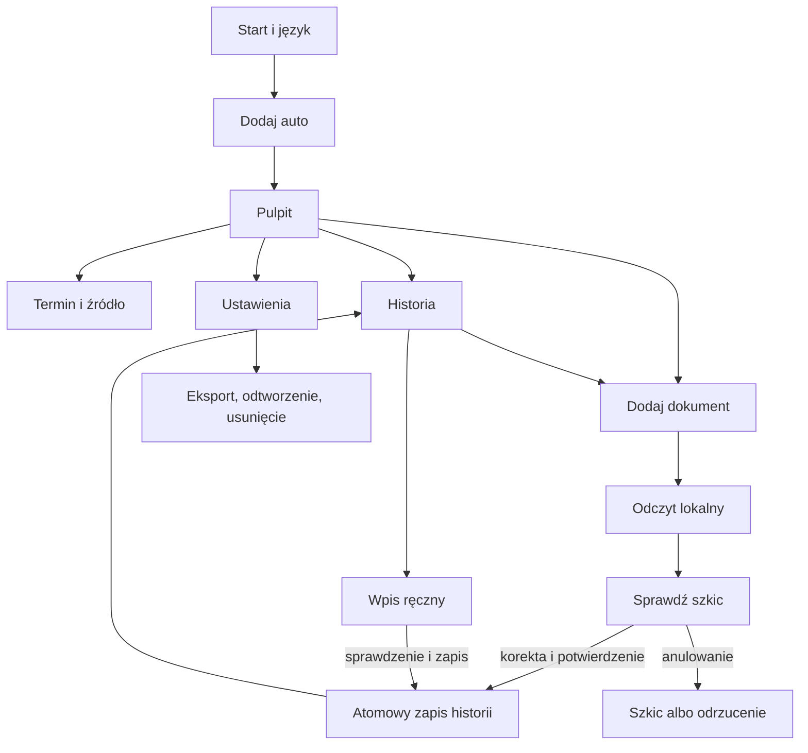

# Ekrany i przepływy

Specyfikacja UX dla Androida, Bokmål/English. Opisy projektowe są po polsku. Wymiary makiety są orientacyjne; w aplikacji używamy jednostek dp/sp i elastycznego układu, nie stałej wysokości ekranu.

## Nawigacja

Trzy zakładki: **Oversikt / Overview**, **Historikk / History**, **Innstillinger / Settings**. Aktywny samochód widoczny na pulpicie i historii. W MVP główny proces obejmuje jedno auto; zmiana aktywnego auta nie może pomieszać szkiców ani dokumentów różnych pojazdów.

Dodawanie wpisu i dokumentu to procesy otwierane z pulpitu/historii. Android Back wraca do poprzedniego kroku. Przy opuszczaniu zmienionego formularza: „Zachować szkic / Odrzucić / Kontynuować edycję”; nie blokujemy wyjścia z niezmienionego formularza.

## Katalog ekranów

### S01 — Start i język

Krótko: uporządkuj historię i zobacz najbliższy serwis. Wybór „Norsk bokmål / English”. Domyślnie język systemu, `nb`/`nb-NO` → Bokmål; pozostałe nieobsługiwane → English. W aplikacji język można zmienić później; nie zmieniamy treści oryginalnych dokumentów.

CTA: **Legg til bil / Add a car**. Informacja, że dane historii są lokalne, bez zakładania konta. Link do zasad prywatności; żadnych uprawnień aparatu/powiadomień przy starcie. Po pierwszym dodaniu auta kolejne uruchomienie prowadzi do pulpitu.

### S02 — Dodaj/edytuj auto

Podstawowe pola: marka/model lub własna nazwa, rok modelowy (może być nieznany), przebieg i data odczytu. VIN i tablica opcjonalne. Dodatkowe pola konfiguracji dostępne pod „Dane do dopasowania harmonogramu”: kod silnika, skrzyni, rynek pierwotnej sprzedaży, tryb serwisowy. Przy każdym polu możliwość „Nie wiem”. Nie zmuszamy użytkownika do zgadywania.

Rok modelowy nie jest rokiem pierwszej rejestracji. Data pierwszej rejestracji jest osobnym polem i może być potrzebna dopiero dla konkretnej reguły. Walidacja: przebieg nieujemny, brak daty przyszłej dla faktycznego odczytu, VIN normalizowany, jeśli podany; brak danych nie blokuje prowadzenia historii. Nie stosujemy uniwersalnej sumy kontrolnej VIN jako warunku poprawności wszystkich europejskich aut.

CTA: **Lagre bil / Save car**. Gdy istniejąca konfiguracja się zmieni, dotychczasowy plan wymaga ponownej oceny dopasowania, zamiast zachować odznakę zgodności. W prototypie pola są skrócone; to nie obietnica automatycznego lookupu VIN.

### S03 — Pulpit

Hierarchia: auto → przebieg z datą odczytu → status harmonogramu → lista czynności → dodanie dokumentu/wpisu. Bez oceny liczbowej stanu mechanicznego.

Karta czynności zawiera nazwę, status tekstowy, termin km i/lub datę, podstawę oraz oznaczenie pochodzenia. Jeżeli oba wymiary są obowiązujące według źródła, pokazujemy oba. Prognozowana data z tempa jazdy jest oznaczona jako szacunek; data kalendarzowa reguły nie jest nazywana prognozą. Na tym etapie makieta pokazuje przykładowe wartości własnego interwału.

Stany nie są jednym „kolorem zdrowia”:

- **Zaległe** — dopiero gdy mamy podstawę wyliczenia i przekroczony termin.
- **Zbliżające się** — na podstawie jawnej preferencji progowej; próg przypomnienia nie jest nowym interwałem producenta.
- **Bez bliskiego terminu** — nie oznacza potwierdzenia dobrego stanu auta.
- **Potrzebne dane** — brak historii, konfiguracji, aktualnego przebiegu lub aktualnego źródła.

Brak planu: wyjaśnienie + „Uzupełnij dane auta” + „Ustaw własny interwał”; historia i dokumenty nadal działają. Brak historii: „Brak potwierdzenia w dodanej dokumentacji”, bez automatycznego liczenia od zera km. Stary odczyt: data ostatniego pomiaru i „Zaktualizuj przebieg”. Offline: lokalne dane i OCR dostępne; nieudany lookup/aktualizacja źródła ma własny stan i przycisk ponowienia po połączeniu.

### S04 — Szczegóły czynności i źródła

Nazwa, stan, obie granice czasu/km (jeśli mają zastosowanie), ostatnie potwierdzenie i opis sposobu liczenia. Link do wpisu historycznego i dokumentu źródłowego użytkownika. Osobno źródło reguły: dostawca/dokument, wersja, data weryfikacji, zakres konfiguracji i aktualność.

Własny interwał: etykieta **Eget intervall / Custom interval**, edycja i wyłączenie po potwierdzeniu. Nie otrzymuje etykiety „zalecenie producenta”. Jeśli istnieje również reguła ze źródła, pokazujemy osobne pochodzenie; nie nadpisujemy jej po cichu. Sam fakt zapisu własnego interwału nie oznacza wykonania usługi.

Plan producenta: dopasowanie tylko po spełnieniu wszystkich wymaganych pól i warunków licencji. Przypadek zależny od zmiennego wskaźnika: opis konieczności sprawdzenia auta, bez sztucznego stałego terminu.

### S05 — Historia i wpis

Oś czasu uporządkowana po dacie wykonania, a nie dacie importu. Wpis: data, przebieg jeśli znany, wykonane czynności, notatka/koszt opcjonalnie, typ pochodzenia i dokumenty. Wpis ręczny także jest potwierdzeniem użytkownika, nie niezależną certyfikacją warsztatu.

Pusta historia ma CTA „Dodaj dokument” i „Dodaj ręcznie”. Dokumenty w trakcie sprawdzania są w osobnej sekcji **Utkast / Drafts** i nie występują na osi wykonanych usług. Edycja lub usunięcie wpisu przelicza odpowiednie wyniki; usuwanie wymaga potwierdzenia z wyjaśnieniem wpływu na terminy.

### S06 — Wpis ręczny / edycja

Wymagane: data wykonania i co najmniej jedna wykonana czynność. Przebieg może być nieznany — zapiszemy historię, ale pokażemy ograniczenie obliczeń km. Dla czynności wybór operacji, np. „wymiana”, „kontrola”, „test”; kontrola oleju nie resetuje reguły wymiany oleju.

Koszt jako opcjonalna kwota NOK, zapisana w najmniejszej jednostce waluty, nie liczba zmiennoprzecinkowa. Przyszła data nie może stać się wykonaną usługą. Przebieg mniejszy niż sąsiedni chronologicznie odczyt: ostrzeżenie i korekta; świadomy wyjątek, np. wymiana licznika, wymaga opisu i nie ustala automatycznie bieżącego odczytu.

CTA **Lagre service / Save service**. Po zapisie potwierdzenie i przejście do historii. Jeżeli data/przebieg mogłyby zastąpić bieżący odczyt, osobny wybór „Użyj jako aktualnego odczytu”. Nigdy nie wybieramy automatycznie największej liczby.

### S07 — Dodaj dokument

Aktualne auto w nagłówku. Dwie ścieżki: aparat i wybór zdjęcia/PDF. Opis obsługiwanych formatów oraz limitów przed wyborem: propozycja 20 MB i 20 stron. Aplikacja użyje systemowego wyboru pliku; brak szerokiego dostępu do galerii na zapas.

Po wyborze: podgląd, nazwa, liczba stron i możliwość usunięcia/zamiany. CTA **Les dokument / Read document**. Podczas przetwarzania postęp stron i anulowanie. Awaria lokalnego odczytu nie wymaga połączenia z internetem; ponowienie nie wysyła dokumentu do chmury.

Duplikat: pokaż istniejący dokument zamiast dopisać ponownie. Niepewne podobieństwo: ostrzeżenie, możliwość porównania. Obcy VIN/tablica: blokada potwierdzenia dla tego auta do wyjaśnienia; przenieś szkic do właściwego pojazdu albo popraw błędny odczyt, a nie „ignoruj wszystko”.

### S08 — Sprawdź odczyt

Nazwa auta i dokumentu; przycisk podglądu oryginału (na telefonie przełączanie formularz/strona). Pola daty wykonania i przebiegu, lista propozycji czynności z zaznaczeniem oraz operacją. Dla każdego wyniku fragment strony; niepewne wartości mają tekst „Sprawdź”. Data wystawienia faktury jest osobną informacją, nie automatycznie datą usługi.

Użytkownik oznacza typ dokumentu: wykonana usługa / zalecenie / wycena / zakup części / nie wiem. Tylko potwierdzone wykonane czynności przechodzą do historii usług. Pozostały dokument można zachować jako załącznik, bez resetowania terminu.

Zapis zablokowany, dopóki nie ma poprawnej daty, przynajmniej jednej wybranej wykonanej czynności i potwierdzenia **Jeg har kontrollert opplysningene / I have checked these details**. Nie wymagamy wymyślenia brakującego przebiegu; jego brak ogranicza wynik. Zmiana jakiegokolwiek pola po zaznaczeniu potwierdzenia odznacza je. Zmiana pojazdu unieważnia dopasowanie i wymaga ponownego sprawdzenia.

CTA **Bekreft og lagre / Confirm and save** jest jednorazowe dla szkicu. Podwójne kliknięcie nie tworzy dwóch usług. Przycisk powrotu oferuje zachowanie szkicu lub odrzucenie. Ponowny OCR tworzy nową próbę i nie kasuje po cichu ręcznych poprawek.

### S09 — Ustawienia i dane

Język, ustawienia powiadomień, aktualizacja przebiegu, eksport/odtworzenie, usuwanie danych, prywatność i wsparcie. Uprawnienie powiadomień wyłącznie po włączeniu przypomnień; odmowa nie blokuje pulpitu. Brak konta oznacza brak sekcji logowania i kasowania konta.

Eksport: historia i własne dokumenty, wybór miejsca zapisu, ostrzeżenie o prywatnej zawartości. Odtworzenie: podgląd zakresu, zgodność wersji, duplikaty i świadomy wybór zastąpienia/połączenia przed zmianą bazy; żadnych importowanych ścieżek plikowych wykonywanych bez walidacji. Usunięcie całego garażu: potwierdzenie opisujące wpisy, dokumenty i przypomnienia, z opcją wcześniejszego eksportu. Osobny eksport nie znika po usunięciu danych aplikacji.

## Dostępność i tłumaczenia

- Dotykowe elementy docelowo co najmniej 48 dp; aktywne stany także opisem/ikoną.
- Czytelna hierarchia, odpowiedni kontrast, przewijanie i brak ucinania po powiększeniu tekstu.
- Opisy pól, kolejność fokusu, komunikaty odczytywalne przez TalkBack; błędy przy polu i skrót na górze.
- Daty i liczby zgodne z językiem; odczytany tekst pozostaje oryginalny. `nb-NO` nie oznacza Nynorsk.
- Angielski fallback, pełny zestaw kluczy dla obu języków. W makiecie komunikaty techniczne przeglądu są poza telefonem.
- Przed wydaniem przegląd Bokmål i terminologii serwisowej; zatwierdzenie makiety nie zastępuje korekty językowej.

## Granica makiety

Interakcje symulują zapisy tylko w pamięci. Nie uruchamiają aparatu, OCR, powiadomień ani eksportu. Brak `localStorage`, sieci i prawdziwych plików wejściowych. Panel scenariuszy poza telefonem służy odbiorowi projektu i nie wejdzie do aplikacji.
